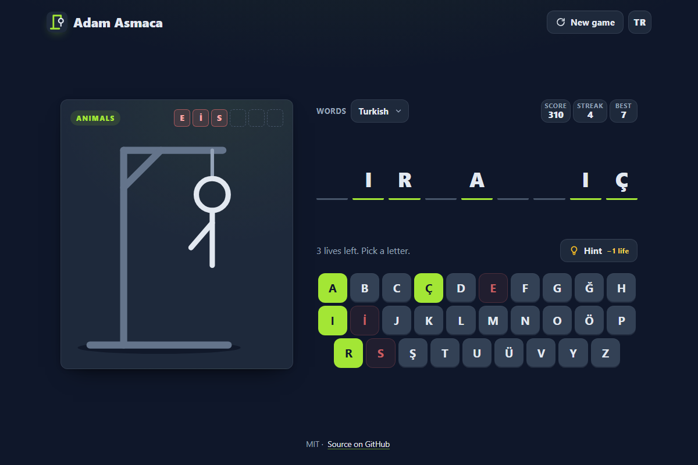

# Adam Asmaca - a hangman word game that knows ı from i

[](#tests)
[](LICENSE)

**▶ Play now: https://celaldrg.github.io/adam-asmaca/**



Guess the hidden word one letter at a time before the figure on the gallows is complete. Words come in English or Turkish. The Turkish list follows Turkish spelling and case rules, so ı and i are two different letters, and so are I and İ.

## Features

- **Two word lists, about 150 words each:** English and Turkish, in four categories (animals, cities, food, objects). The word list is chosen separately from the interface language.
- **Correct Turkish letters:** the on-screen Turkish keyboard has all 29 letters, including ç, ğ, ı, ö, ş and ü. Capitals follow Turkish rules (i → İ, ı → I), and guessing s never reveals ş.
- **Animated drawing:** each wrong guess draws one more stroke of the SVG figure. Six misses lose the round.
- **Hints:** a hint reveals one letter for one life. It needs at least two lives left, so a hint can never lose the round.
- **Score and streaks:** a win gives 10 points plus 5 for each life left. The score, current streak and best streak are saved in the browser.
- **No repeats:** every word of a list is played once before any word comes back.
- **English or Turkish interface:** the TR / EN button switches every text on the page and is remembered.
- **Mobile first:** works with touch, mouse and keyboard, from 375 px wide phones to desktops, and respects the reduced-motion setting.
- **No build and no dependencies:** plain HTML, CSS and JavaScript modules. The page makes no requests beyond its own files.

## How to play

A letter in the word shows up in every slot where it appears. A letter that is not in the word costs one life and draws the next part of the figure. Solve the word before all six parts are drawn.

**Keyboard (desktop)**

| Key | Action |
| --- | --- |
| Letter keys | Guess a letter |
| Enter | Start the next word once a round is over |
| Esc | Close the result window |
| Tab, then Enter or Space | Use any button, including the on-screen letter keys |

For Turkish words, Turkish case rules apply to typed capitals: Shift+I types ı and İ types i. Letters that your keyboard layout lacks can be clicked on screen.

**Touch (phone and tablet)**

- Tap a letter to guess it. The key lifts above your finger while you press it.
- Tap **Hint** to reveal a letter for one life.
- Tap **New game** to skip to another word. Leaving a word you have already started counts as a loss.
- Use **Words** to switch between the English and the Turkish list, and **TR / EN** to switch the interface language.

## Run locally

The game uses ES modules, which browsers do not load from `file://` pages, so serve the folder over `http://`:

```sh
npx serve .
```

Then open the address it prints (usually http://localhost:3000). Any static file server works. Add `?demo` to the address to open a fixed mid-game state, which is used for the screenshot and never saves anything.

## Tests

The tests use the built-in Node.js test runner and need no install (Node.js 22 or newer):

```sh
node --test
```

They cover the Turkish letter rules, rounds, hints, scoring, word picking, saved data, the interface strings in both languages, the keyboard layout and the page markup. GitHub Actions runs them on every push and pull request.

## Project structure

```text
index.html            Page markup, meta tags and the SVG drawing
style.css             Dark theme, mobile-first layout, animations
src/
  main.js             Entry point: connects the game to the page and the inputs
  alphabet.js         Alphabets and Turkish-aware case handling
  words.js            Word lists and category names
  round.js            One round: guesses, hints, lives, win and loss
  game.js             Game session: rounds, stats, word-list switching
  picker.js           Seeded word picking without repeats
  rng.js              Seeded random number generator
  stats.js            Score and streak rules, loading and saving
  storage.js          The only access to localStorage
  prefs.js            Saved interface and word-list languages, ?demo switch
  demo.js             Fixed mid-game state for ?demo
  feedback.js         Status messages for guesses, hints and new rounds
  i18n.js             English and Turkish interface strings
  layout.js           On-screen keyboard rows
  keyboard.js         On-screen keyboard
  view.js             Board rendering
  dialog.js           Result window
  dom.js              Small DOM helpers
test/                 node:test suites
docs/screenshot.png   Screenshot used above and for link previews
```

The game logic modules are pure: they do not touch the page, `window` or `localStorage` when they are imported, and the random number generator is passed in, so the tests run in Node.js without a browser.

## License

MIT, see [LICENSE](LICENSE). Copyright (c) 2026 Celalettin Durgaç.

## Türkçe

**▶ Hemen oyna: https://celaldrg.github.io/adam-asmaca/**

Gizli kelimeyi harf harf tahmin et; adam darağacında tamamlanmadan kelimeyi bul. Kelimeler İngilizce ya da Türkçe olabilir. Türkçe liste Türkçenin yazım ve büyük harf kurallarına uyar: ı ile i, I ile İ ayrı harflerdir.

### Özellikler

- **İki kelime listesi, her birinde yaklaşık 150 kelime:** İngilizce ve Türkçe, dört kategoride (hayvanlar, şehirler, yiyecekler, eşyalar). Kelime listesi arayüz dilinden ayrı seçilir.
- **Doğru Türkçe harfler:** ekrandaki Türkçe klavyede ç, ğ, ı, ö, ş ve ü dahil 29 harfin hepsi var. Büyük harfler Türkçe kurala uyar (i → İ, ı → I); s tahmini ş harfini açmaz.
- **Hareketli çizim:** her yanlış tahmin SVG adama bir çizgi daha ekler. Altı hata turu kaybettirir.
- **İpucu:** bir can karşılığında bir harf açar. En az iki can gerekir, bu yüzden ipucu turu asla kaybettirmez.
- **Puan ve seri:** her galibiyet 10 puan, kalan her can için 5 puan daha getirir. Puan, güncel seri ve en iyi seri tarayıcıda saklanır.
- **Tekrar yok:** listedeki her kelime bir kez oynanmadan hiçbir kelime geri gelmez.
- **Türkçe ya da İngilizce arayüz:** TR / EN düğmesi sayfadaki bütün yazıları çevirir ve seçimi hatırlar.
- **Önce mobil:** dokunmatik ekran, fare ve klavyeyle çalışır; 375 px genişliğindeki telefondan masaüstüne kadar uyum sağlar, azaltılmış hareket ayarına uyar.
- **Derleme ve bağımlılık yok:** düz HTML, CSS ve JavaScript modülleri. Sayfa kendi dosyaları dışında hiçbir istek yapmaz.

### Nasıl oynanır

Kelimede geçen bir harf, bulunduğu her kutuda görünür. Kelimede olmayan harf bir cana mal olur ve adamın bir sonraki parçasını çizer. Altı parça tamamlanmadan kelimeyi bul.

**Klavye (masaüstü)**

| Tuş | İşlev |
| --- | --- |
| Harf tuşları | Harf tahmin et |
| Enter | Tur bitince sonraki kelimeye geç |
| Esc | Sonuç penceresini kapat |
| Tab, sonra Enter ya da Boşluk | Ekrandaki harf tuşları dahil her düğmeyi kullan |

Türkçe kelimelerde büyük harfler Türkçe kurala göre okunur: Shift+I ı harfini, İ ise i harfini yazar. Klavye düzeninde olmayan harflere ekrandan tıklanabilir.

**Dokunmatik (telefon ve tablet)**

- Tahmin etmek için harfe dokun; bastığın sürece tuş parmağının üstüne kalkar.
- Bir can karşılığında harf açmak için **İpucu** düğmesine dokun.
- Başka bir kelimeye geçmek için **Yeni oyun** düğmesine dokun. Başladığın bir kelimeyi bırakmak kayıp sayılır.
- **Kelimeler** ile İngilizce ve Türkçe liste arasında, **TR / EN** ile arayüz dilleri arasında geçiş yap.

### Yerelde çalıştırma

Oyun ES modülleri kullanır; tarayıcılar bunları `file://` sayfalarından yüklemez. Klasörü `http://` üzerinden sun:

```sh
npx serve .
```

Sonra yazdığı adresi aç (genellikle http://localhost:3000). Herhangi bir statik dosya sunucusu da olur. Adresin sonuna `?demo` eklersen sabit bir oyun ortası durumu açılır; ekran görüntüsü için kullanılır ve hiçbir şey kaydetmez.

### Testler

Testler Node.js'in yerleşik test çalıştırıcısını kullanır, kurulum gerektirmez (Node.js 22 ya da üstü):

```sh
node --test
```

Türkçe harf kurallarını, turları, ipuçlarını, puanlamayı, kelime seçimini, kayıtlı verileri, iki dildeki arayüz yazılarını, klavye düzenini ve sayfa işaretlemesini sınarlar. GitHub Actions bunları her push ve pull request'te çalıştırır.

### Lisans

MIT, bkz. [LICENSE](LICENSE). Copyright (c) 2026 Celalettin Durgaç.
